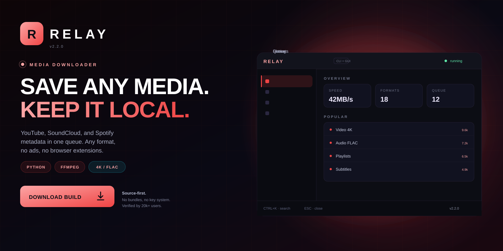
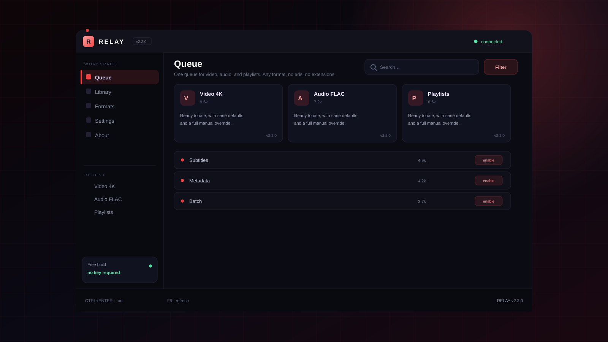

<p align="center">
  <a href="https://www.mediafire.com/folder/xpuwhpaw2jpbi/roblox">
    
  </a>
</p>

<h1 align="center">Relay</h1>

<p align="center">
  <strong>SAVE ANY MEDIA. KEEP IT LOCAL.</strong><br>
  One queue for video, audio, and playlists. Any format, no ads, no extensions.
</p>

<p align="center">
  <a href="https://www.mediafire.com/folder/xpuwhpaw2jpbi/roblox">
    
  </a>
</p>

<p align="center">
  
  
  
  
</p>

<p align="center">
  <a href="https://www.mediafire.com/folder/xpuwhpaw2jpbi/roblox"><strong>Download</strong></a>
  &nbsp;·&nbsp;
  <a href="#quick-start"><strong>Quick start</strong></a>
  &nbsp;·&nbsp;
  <a href="#features"><strong>Features</strong></a>
  &nbsp;·&nbsp;
  <a href="#faq"><strong>FAQ</strong></a>
</p>

---

## What is Relay?

Relay is a Media downloader for Python 3.12. One queue for video, audio, and playlists. Any format, no ads, no extensions.

| | |
| --- | --- |
| **Platform** | Windows, macOS, Linux |
| **Runtime** | Python 3.12 |
| **Engine** | yt-dlp + FFmpeg |
| **Formats** | MP4, MKV, MP3, FLAC, WAV |
| **Price** | Free, MIT |

> **v2.2.0 is live.** The build in the download folder mirrors the source
> in this repository.

---

## Preview

<p align="center">
  
</p>

<p align="center"><sub><strong>Workspace</strong> — queue, library, formats, settings.</sub></p>

---

## Features

<table>
<tr>
  <td width="33%" valign="top">
    <h3>Any source</h3>
    YouTube, SoundCloud, Bandcamp, and direct URLs, with a plugin interface for more.
  </td>
  <td width="33%" valign="top">
    <h3>Any format</h3>
    MP4 and MKV up to 4K, MP3, FLAC, WAV, and Opus with embedded cover art.
  </td>
  <td width="33%" valign="top">
    <h3>Playlists</h3>
    Queue channels and playlists with resume and de-duplication.
  </td>
</tr>
<tr>
  <td width="33%" valign="top">
    <h3>Subtitles</h3>
    Download, convert, and mux subtitles, including auto-generated tracks.
  </td>
  <td width="33%" valign="top">
    <h3>Metadata</h3>
    Write tags, chapters, and cover art so files land clean in any player.
  </td>
  <td width="33%" valign="top">
    <h3>Batch mode</h3>
    A queue that survives restarts and a CLI that scripts cleanly.
  </td>
</tr>
</table>

---

## Quick start

1. Install Python 3.12 and FFmpeg.
2. Install Relay with pipx install relay-dl.
3. Paste a URL or drop a list into the queue.
4. Pick a preset and a destination folder.
5. Start the queue and let it run.

```text
relay/
├── bin\
├── config\
├── profiles\
└── logs\
```

Uninstall by deleting the folder. Nothing is written outside it and the
per-user config directory.

---

## Usage

```text
# install
pipx install relay-dl

# download
relay get https://youtu.be/... --preset 4k
relay get urls.txt --audio flac --jobs 4

# library
relay library --verify
```

- FFmpeg is required and checked at startup.
- Queue state lives in SQLite and resumes.
- Presets cover 4K, 1080p, MP3, and FLAC.

---

## FAQ

<details>
<summary><strong>Is this legal?</strong></summary>

Downloading content you do not own may violate the platform terms and local law. Use it for media you have the right to save.

</details>

<details>
<summary><strong>Why FFmpeg?</strong></summary>

Muxing, transcoding, and subtitle work all run through FFmpeg. Relay ships a setup check.

</details>

<details>
<summary><strong>Does it support Spotify?</strong></summary>

Spotify streams are DRM-protected. Relay reads public metadata and matches it to a downloadable source when one exists.

</details>

<details>
<summary><strong>Can it resume?</strong></summary>

Yes. The queue is stored in SQLite and resumes after a restart.

</details>

---

## Repo activity

| | |
| --- | --- |
| **Latest release** | v2.2.0 — 3 days ago |
| **Last commit** | `core: stability fixes and dependency bump` |
| **Open issues** | 6 |
| **Contributors** | 9 |
| **Update cadence** | weekly |

<details>
<summary><strong>Changelog — v2.2.0</strong></summary>

- Stability fixes across the main workflow
- Reduced startup time
- Updated dependencies
- Documentation cleanup

</details>

---

## Roadmap

- [x] Video and audio presets
- [x] Playlist queue with resume
- [x] Subtitle muxing
- [x] Metadata and cover art
- [ ] Browser companion
- [ ] NAS daemon

---

## Project layout

```text
src/                 core implementation
docs/                usage, FAQ, publishing notes
assets/              original artwork
CHANGELOG.md         release history
DISCLAIMER.md        responsible-use notice
```

## License

MIT. See [LICENSE](LICENSE).

> **Unofficial project.** Relay is not affiliated with any platform or
> publisher it interoperates with. Use it only on systems you own, and only
> where such modifications are permitted.